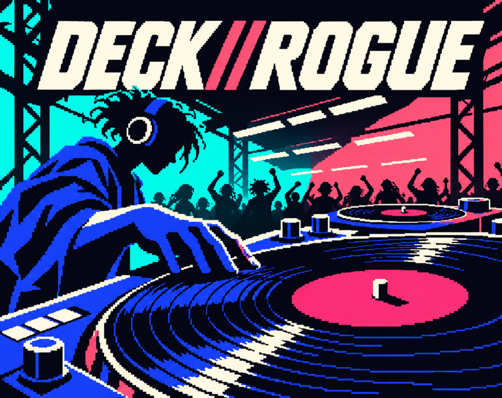

<p align="center">
  
</p>

<p align="center">
  <strong>Симулятор диджея.</strong><br>
  Сводишь сет на пульте, клуб живёт выступлением, дальше пускают только если зал тебя принял.
</p>

<p align="center">
  Pixel DJ roguelite · Unity 6000.4.0f1 · C#
</p>

---

Ты не жмёшь кнопки под готовый трек. Ты ведёшь ночь: меняешь пластинки, строишь динамику и слышишь, принял ли танцпол. Клубы разные. Проход дальше — это реакция зала, а не таймер.

Полное видение: [`Doc/00_VISION.md`](Doc/00_VISION.md).

## Открыть проект

1. Unity **6000.4.0f1** (`DJ/ProjectSettings/ProjectVersion.txt`).
2. Открыть папку `DJ/`.
3. Сцены в Build Settings, по порядку: `Boot` → `MainMenu` → `AudioSpike`. Старт с `Boot`.

Нужны модули Windows Standalone, WebGL и Android (SDK, NDK, OpenJDK). Если модуль ставился при открытом редакторе, перезапусти Unity — иначе Android не появится в Build Profiles.

## Сейчас в игре

| | |
|---|---|
| Оболочка | `Boot` показывает версию и «Включить звук». `MainMenu` — бренд, Start Run, Settings, Quit. Android зафиксирован в landscape. |
| Настройки | Музыка, SFX, масштаб UI, reduced flashing, заготовка языка. JSON в `persistentDataPath`, запасной путь — PlayerPrefs. |
| Часы | 120 BPM, 4/4, фраза 8 тактов. Фаза от абсолютного времени, не от `Time.deltaTime`. Команда, которая не успела на границу, уходит на следующую долю, такт или фразу. |
| Пульт | Две деки, по три стема, старт через `PlayScheduled` на DSP-часах, квант — следующий такт. Короткий кроссфейдер. |
| Пластинки | Neon Pulse, Bass Reactor, Afterhours, City Static. Тап по диску меняет пластинку; если дека уже играет, звук переключается сразу. |
| Зал | Танцпол сверху экрана, пульт его не перекрывает. |

Доменные типы в `DJ/Assets/_Game/Core` не ссылаются на `UnityEngine`.

Карта слоёв и приёмка — в [`Doc/DECK_ROGUE_MASTER.md`](Doc/DECK_ROGUE_MASTER.md). Ближайший игровой шаг после текущего среза — акт до босса The Signal: [`Doc/01_GDD.md`](Doc/01_GDD.md), [`Doc/16_MUSIC_ACT1.md`](Doc/16_MUSIC_ACT1.md), [`Doc/19_ART_DIRECTION_JRPG.md`](Doc/19_ART_DIRECTION_JRPG.md), [`Doc/15_ROADMAP.md`](Doc/15_ROADMAP.md).

## Репозиторий

| Путь | Что внутри |
|---|---|
| `DJ/` | Unity-проект: сцены, пульт, зал, лупы |
| `Doc/` | Видение, GDD, MVP, музыка и арт акта 1 |
| `tests/` | Доменные тесты, без Unity |
| `tools/GenerateTestLoops/` | Генератор тестовых лупов |
| `Itch/` | Обложка, логотип, фон |

Сборки Windows, Web и Android в git не входят: это локальные пакеты, а APK больше лимита GitHub в 100 МБ.

## Тесты

```powershell
dotnet test tests/DeckRogue.Core.Tests/DeckRogue.Core.Tests.csproj
```

Те же кейсы подключены как Unity EditMode: `DJ/Assets/_Game/Tests/EditMode`.

## Документы

| | |
|---|---|
| [Видение](Doc/00_VISION.md) | North star: пульт, живой зал, две разные прогрессии |
| [GDD](Doc/01_GDD.md) | Правила акта и пульта |
| [MVP](Doc/14_MVP.md) | First Gig: что обязательно в первой играбельной версии |
| [Роадмап](Doc/15_ROADMAP.md) | Порядок работ |
| [Музыка акта 1](Doc/16_MUSIC_ACT1.md) | Пулы и пластинки |
| [Аудио](Doc/06_AUDIO_TECH.md) | Часы, стемы, расписание |
| [Арт](Doc/19_ART_DIRECTION_JRPG.md) | JRPG-направление акта |
